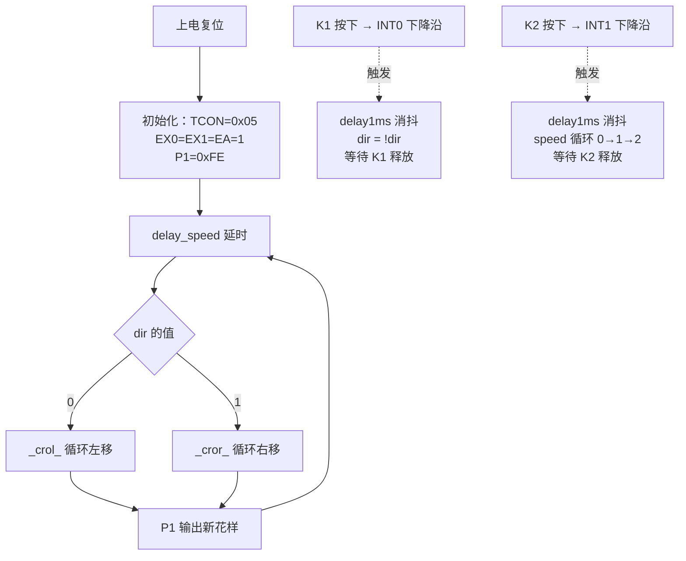

# C51 外部中断按键控制 LED 流水灯


基于 **AT89C51** 的 8 位 LED 流水灯实训项目。两个按键分别接到外部中断 **INT0 / INT1**，按下即可实时改变流水的**方向**与**速度**；主循环只负责移位与输出，中断服务程序只修改状态变量。项目包含 Keil C51 工程、Proteus 仿真工程、预编译固件与讲解 PPT。

## 功能

| 操作 | 引脚 | 中断源 | 现象 |
| --- | --- | --- | --- |
| 按下 K1 | P3.2 | INT0（中断号 0） | 流水方向反转：左移 ↔ 右移 |
| 按下 K2 | P3.3 | INT1（中断号 2） | 速度在三档间循环：慢 → 中 → 快 → 慢 |

设计要点：

- **下降沿触发**：`TCON = 0x05` 置位 `IT0`、`IT1`，按键低电平有效，长按只触发一次。
- **中断只改标志**：ISR 仅写 `dir` / `speed`，不直接操作 `P1`，输出动作全部留在主循环，符合"中断要短"的原则。
- **寄存器组切换**：`using 1` / `using 2` 让两个 ISR 使用独立的工作寄存器组，省去现场保护开销。
- **速度表放 ROM**：`unsigned char code DELAY_TAB[3]` 用 `code` 关键字存于程序区，不占用片内 RAM。
- **资源占用**：`code = 299 B`，`data = 26.1 B`（Keil C51，Small 模式）。

## 硬件连接

| 单片机引脚 | 外接器件 | 说明 |
| --- | --- | --- |
| P1.0 ~ P1.7 | 8 只 LED + 220 Ω 限流电阻 | 共阳（灌电流）接法，端口输出 `0` 时对应 LED 点亮 |
| P3.2 / INT0 | 按键 K1 | 按下接地，低电平有效 |
| P3.3 / INT1 | 按键 K2 | 按下接地，低电平有效 |
| XTAL1 / XTAL2 | 12 MHz 晶振 + 22 pF 电容 | 决定延时基准 |
| RST | 复位电路 | 上电复位 |

限流电阻取 220 Ω 时单路电流约 10 mA，处于普通 LED 的正常工作范围。

## 程序设计



中断服务程序的核心只有三句：

```c
void int0_isr(void) interrupt 0 using 1
{
    delay1ms();          /* 软件延时消抖 */
    dir = !dir;          /* 只翻转方向标志 */
    while (K1 == 0) { }  /* 等待按键释放，保证长按只响应一次 */
}
```

主循环里没有任何 `if (speed == ...)` 之类的档位判断，而是直接用 `DELAY_TAB[speed]` 作为延时循环上限，增删档位只需改表：

```c
void delay_speed(void)
{
    unsigned char i, j;
    for (i = 0; i < DELAY_TAB[speed]; i++)
        for (j = 0; j < 200; j++)
            _nop_();
}
```

## 速度档位

| `speed` | `DELAY_TAB` 值 | 流水效果 |
| --- | --- | --- |
| 0 | 200 | 慢 |
| 1 | 150 | 中 |
| 2 | 50 | 快 |

数值越大，空循环次数越多，移位间隔越长，流水越慢。修改 `DELAY_TAB` 即可自定义节奏。

## 目录结构

```
.
├── keil5/                        Keil C51 / EIDE 工程
│   ├── LED_FlowLight.c           主程序：中断服务程序 + 主循环
│   ├── STARTUP.A51               启动代码
│   ├── LED_FlowLight.uvproj      Keil µVision 工程文件
│   ├── .eide/                    EIDE（VSCode）工程配置
│   └── .clang-format             代码风格配置
├── Proteus/
│   └── LED_FlowLight.pdsprj      Proteus 8 仿真工程
├── firmware/
│   └── LED_FlowLight.hex         预编译固件，可直接加载仿真或烧录
└── 榜五_中断式按键响应系统_汇报.pptx   设计思路讲解
```

## 快速开始

**1. Proteus 仿真（不装 Keil 也能跑）**

打开 `Proteus/LED_FlowLight.pdsprj` → 双击 AT89C51 → `Program File` 选择 `firmware/LED_FlowLight.hex` → 点击左下角运行。按 K1 换向，按 K2 换档。

**2. Keil µVision**

打开 `keil5/LED_FlowLight.uvproj` → `Rebuild` → 生成的 HEX 位于 `keil5/Objects/`，将其加载到仿真中的单片机即可。

**3. VSCode + EIDE**

用 VSCode 打开 `keil5/` 目录，EIDE 插件会自动识别 `.eide/eide.yml`（目标 `Target_1`，工具链 `Keil_C51`），构建产物输出到 `keil5/build/`。

## 说明与可改进点

- `delay1ms()` 只是**弱消抖**：它延时后无条件翻转标志，真正的防抖效果来自其后 `while (K1 == 0)` 等待释放。
- 等待释放的 `while` 循环在 ISR 内执行，长按期间会**阻塞另一路中断**，两键同时按下时响应会延迟。若需完全并发，可把消抖与等待释放移到主循环，ISR 只置位标志，配合定时器做 10 ms 扫描。
- 边沿触发方式下按键抖动可能造成极少数情况下的重复触发；对可靠性要求高的场合建议改用查询 + 定时器消抖方案。

## License

[MIT](LICENSE)
